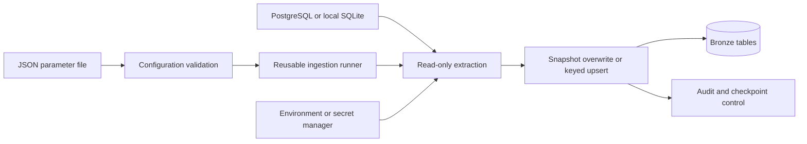

# Reusable ingestion framework

**Add a table through configuration, not another ingestion notebook.**

An original equipment-rental example with fictional `depots`, `equipment` and
`rental_orders` tables. A reusable runner reads a parameter file, extracts source
data, writes a Bronze current-state copy, and records audits and checkpoints.
The local demo is executable without Databricks, a database account or API keys.



## Run locally

Python 3.9+; standard library only. Run commands from this repository root:

```sh
python3 -m ingestion seed
python3 -m ingestion validate --config config/local.json
python3 -m ingestion run --config config/local.json
python3 -m ingestion audit --config config/local.json
# Simulate an updated record, then rerun the SAME framework:
python3 -m ingestion change
python3 -m ingestion run --config config/local.json
python3 -m unittest discover -s tests -v
```

The first run loads 2 depots, 2 equipment records and 2 rental orders. Reruns
preserve those row counts; the change command updates one rate and version.
Outputs and audits are in ignored `runtime/bronze.db`. Each Bronze table stores
a JSON `_payload`, deterministic `_record_key`, `_run_id` and `_ingested_at`.
JSON decimals/dates use string representations. This local storage format
illustrates the control flow, not a high-volume lakehouse storage implementation.

## Add a table or source

Add a table entry to `config/local.json` or `config/postgres.json`:

```json
{
  "name": "bronze_equipment",
  "source": "rental_system",
  "schema": "rental_demo",
  "table": "equipment",
  "columns": ["equipment_id", "equipment_name", "daily_rate", "change_version"],
  "keys": ["equipment_id"],
  "mode": "incremental",
  "watermark": "change_version",
  "lookback": 0,
  "max_rows": 50000,
  "retries": 1
}
```

Use a unique `name` for every ingestion task. `full` replaces the table snapshot,
including an empty source; `incremental` upserts changed records by business key.
Explicit columns act as a source schema contract: missing columns fail. New
unselected columns do not get ingested automatically. Do not put SQL expressions,
filters or credentials into the configuration.

Add another connection under `sources` and reference its name from table entries.
More tables on a supported connector generally need configuration only. A new
source technology needs a connector implementation and tests. Local execution is
sequential with bounded batches, not unlimited throughput. Source systems must
have capacity for the extraction workload.

## PostgreSQL example, including Neon

The tables here are entirely fictional and separate from the earlier sales demo.
Use your own PostgreSQL database; no hosted database is created automatically.

```sh
python3 -m venv .venv
.venv/bin/python -m pip install -r requirements-postgres.txt
```

Supply `PG_SOURCE_DSN` privately through your environment or secret manager. It
should be a SELECT-only login, using TLS (`sslmode=require` for Neon). The project
does not auto-load `.env` files and never prints DSNs. `.env.example` lists the
names only. Don't copy credentials into Git or shell commands you share publicly.

To create the fictional source tables, supply `PG_SETUP_DSN` privately with schema
creation rights, then explicitly run:

```sh
.venv/bin/python -m ingestion.seed_postgres --apply
.venv/bin/python -m ingestion run --config config/postgres.json
```

Grant the source login `USAGE` on schema `rental_demo` and `SELECT` on its three
tables before ingestion. The setup login is not used by extraction. Seeding
creates a separate schema and inserts missing sample IDs; it does not overwrite
existing rows. Test this against a development database first.

## Databricks JDBC to Delta adapter

`databricks_adapter/run.py` uses Spark JDBC reads and distributed Delta writes; it never
collects source rows onto the driver. The configuration still enforces a bounded
row count. The PostgreSQL JDBC driver must be installed on the compute.

1. Add this repository as a Databricks Git folder / job library.
2. Provision a Unity Catalog catalog and permissions for the job principal.
3. Set `catalog`, `bronze_schema` and `control_schema` in `config/databricks.json`.
4. Supply `RENTAL_JDBC_URL`, `RENTAL_JDBC_USER`, `RENTAL_JDBC_PASSWORD` via your
   secret manager. Use a SELECT-only source account; no credentials in the URL.
   Map additional source names to their own environment prefixes in `jdbc_sources`.
5. From a notebook whose working directory is the repository root:

```python
from databricks_adapter.run import run
results = run(spark, "config/databricks.json")
display(results)
```

Configure **one concurrent job run** per configuration and let Databricks Jobs
retry failed tasks. Incremental loads use an actual Delta `MERGE`, not append
labeled as upsert. Full loads overwrite the current-state snapshot. Target schema
changes require deliberate configuration/migration; automatic mergeSchema is off.
Default table writes use the runtime's schema-compatibility checks. Bronze rows
include `_ingest_run_id` and `_ingested_at` metadata.

**Verification:** local SQLite behavior is tested. The PostgreSQL adapter and
Databricks/JDBC/Delta adapter are supplied as implementation examples, not claimed
as integration-tested here. No Databricks compute was available.

## Audit, failure and checkpoint semantics

- Each attempt records a UUID, table, load mode, attempt (local), start/end times,
  status, extracted count, watermarks and an error class. Raw exception strings,
  SQL, connection URLs and credentials are not written to application audits.
- Local Bronze writes, checkpoint advancement and success audit update commit in
  one SQLite transaction. Failures roll back target/checkpoint changes and are
  recorded separately. Other configured tables can still execute; CLI exits 1
  if any fail. Only classified transient source errors are retried.
- Databricks Delta tables commit independently. A target write completes BEFORE
  watermark advancement. A crash between them can cause replay; keyed MERGE
  prevents duplicate business keys. This is not an exactly-once multi-table
  transaction. Partial job success is possible; inspect per-table audits.
- A process kill can leave `STARTED` audits. Reconcile stale runs operationally;
  an unavailable audit store must not be interpreted as successful ingestion.
- Engine/runtime logs have their own redaction settings. Review Spark logging
  and access controls before production; sanitized application audit fields alone
  do not secure all platform logs.

## Incremental assumptions and limits

This demo intentionally uses a non-null integer `change_version`, not timestamps.
It must increase on every relevant source change and be suitable for commit-order
extraction. The lower bound is inclusive (`>= last_watermark - lookback`) and the
upper bound is captured for each load. Inclusive replay handles equal-watermark
rows; it does not replace a robust source CDC contract.

The local PostgreSQL reader uses one repeatable-read, read-only snapshot. Spark
JDBC uses separate reads for bounds and rows and does NOT guarantee a shared source
snapshot. Sources that mutate during extraction need a consistent snapshot or
commit-aware CDC design before production use. The adapters are not equivalent
in snapshot guarantees.

Late records below the lookback range, hard deletes, CDC tombstones, SCD Type 2,
streaming, arbitrary SQL, cross-table source snapshots, automatic schema evolution
and concurrent writers to the same target are outside this implementation.
A raw immutable change-event archive should precede this current-state Bronze
pattern when history/replay requirements demand it. Partitioned JDBC reads,
source throttling, distributed orchestration, data classification and performance
benchmarks are necessary extensions for production scale, not claims of this demo.

## Repository map

```text
config/                Parameter files, never credentials
examples/              Optional reference SQL
ingestion/            Validation, adapters, runner, CLI and synthetic fixtures
databricks_adapter/    Optional JDBC-to-Delta implementation
tests/                Runnable correctness and failure-path tests
```

## Sharing

Screenshots, HEIC images, credentials, env files and runtime databases are ignored.
Private reference screenshots are not needed to run the project and must not be
published. No screenshot text, business entities, connection settings or private
code was copied into this example. Review `git status --ignored` before publishing.
No commit, push, live PostgreSQL write or Databricks deployment is performed by
creating this repository.

References: [Spark JDBC](https://spark.apache.org/docs/latest/sql-data-sources-jdbc.html),
[Delta MERGE](https://docs.databricks.com/aws/en/delta/merge).
